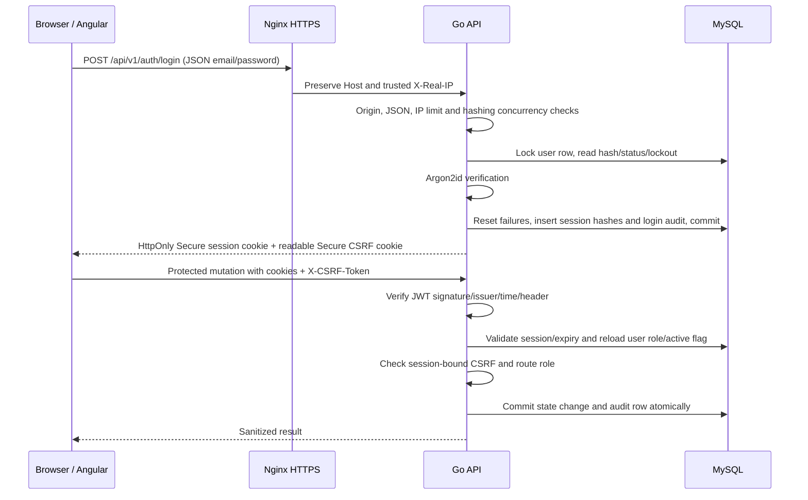

# Authentication, credentials and request flow

## Components

- `internal/security/password.go`: Argon2id password hashes, 64 MiB memory, three iterations, two lanes, random 16-byte salt and a 32-byte result. Only fixed, supported hash parameters are accepted; passwords are 14–1024 bytes at creation.
- `cmd/create-admin` and `cmd/create-user`: local CLI account provisioning. The first admin is protected by a MySQL advisory lock. Role-limited user creation requires an existing active administrator. Account creation and its audit event commit together.
- `internal/security/session.go`: signed HS256 JWTs with random session ID, user ID, informational email/role, issuer, issued-at and expiry. Maximum lifetime is 15 minutes; issuer, signature, header and time claims are validated. JWTs are signed, not encrypted; claims must not contain secrets.
- `migrations/002_sessions.sql`: stores SHA-256 hashes of bearer/CSRF tokens, user ID and expiry. It stores neither usable bearer tokens nor passwords. This allows durable logout/revocation across API restarts.
- `internal/httpapi/auth.go`: login, current user, logout, session lookup, CSRF and RBAC middleware. Current role and active state come from MySQL on every protected request, so role changes do not wait for JWT expiry.
- `internal/httpapi/middleware.go`: origin/JSON checks and bounded login rate/hash concurrency. Nginx adds per-IP edge rate limiting.
- `web/src/app/core`: route guard, typed API requests and same-origin API-only cookie/CSRF interceptor. The guard and hidden controls improve usability; backend middleware enforces permissions.

## Login and protected requests



Login uses a row lock so concurrent attempts cannot reset an already-established lockout. Eight wrong passwords lock an account for 15 minutes. Unknown/inactive/locked accounts perform a dummy Argon2 verification and return the same generic 401. Their failure auditing is best-effort if the database is unavailable; known-user incorrect-password counters and audit are transactional. The API permits ten login requests per source IP/minute per process and four concurrent verifications; the edge is stricter.

Both cookies are host-only, Path=/ and SameSite=Strict; production requires Secure. Only the session cookie is HttpOnly because Angular must read the CSRF cookie. A mutation requires the cookie/header values to match **and** their SHA-256 hash to match the authenticated session's stored hash. Production Origin must equal APP_ORIGIN and its host must equal the preserved request Host. Login also requires JSON and origin checks, preventing HTML-form login CSRF. The app does not enable cross-origin API access.

`GET /auth/me` returns only user ID/email/current role. Logout requires auth and CSRF, deletes that session row with an audit record, then expires both cookies. Replaying the old bearer cookie fails. Expired sessions are rejected by both JWT and SQL checks; login performs bounded cleanup. There is no refresh token, browser localStorage credential, or silent refresh. Manually deleting session rows revokes access; changing the signing key invalidates all JWTs.

## RBAC

| Operation | Admin | Operator | Viewer |
|---|---|---|---|
| Read registered installations / own principal | Yes | Yes | Yes |
| Test a stored PVE connection | Yes | Yes | No |
| Register or remove a manager installation record | Yes | No | No |
| Read audit events | Yes | No | No |
| Sign out own session | Yes | Yes | Yes |

Health and login are public. Removal affects only manager data. Phase 1 has no PVE resource-mutation routes.

## Proxmox credentials

Local sessions authenticate humans to this manager; they are never forwarded to PVE. Each independent PVE installation uses its own privilege-separated API token with PVEAuditor permissions. Its ID is visible inventory metadata, while its secret is accepted only during registration and never returned by API/UI/list/audit.

`internal/security/crypto.go` encrypts API secrets with AES-256-GCM using a fresh nonce and authenticated application context. MySQL stores base64(nonce+ciphertext+tag). A separate 32-byte key is loaded from CREDENTIALS_ENCRYPTION_KEY outside MySQL. An invalid key, modified ciphertext or tag fails decryption. The current encryption format binds the ciphertext to the application, not to a particular database row; a privileged database writer could swap valid encrypted values between records. Restrict database writes, and consider per-record authenticated context and managed key rotation in later hardening.

For a test, `internal/httpapi/servers.go` loads only that record's encrypted secret, decrypts in API memory, then `internal/proxmox/client.go` sends:

```http
Authorization: PVEAPIToken=user@realm!tokenid=installation-secret
```

Only verified HTTPS origins on TCP 8006 are accepted. Custom CA trust extends system roots; TLS verification stays enabled. The custom dialer resolves DNS, filters addresses against the configured CIDRs and dials an approved IP directly, avoiding a second DNS lookup. It ignores proxy environment variables and refuses redirects. Reads are bounded by timeouts, connection limits and a 2 MiB response limit. Version and node-list calls must both return valid data; raw upstream bodies and credentials are not included in errors.

## Audit and limits

Server registration, test result updates, removal, successful login/logout and CLI account creation commit with audit records. If the required audit insert fails, the corresponding state transaction rolls back. Registration itself commits before its initial connection test, so a network failure retains the endpoint and records a failed test. The runtime MySQL account needs SELECT/INSERT on audit_logs, without UPDATE/DELETE. The admin UI/API displays recent events; there is no immutable remote sink or automatic retention.

Secrets exist briefly in browser form fields, HTTPS request bodies and Go process memory. The UI clears them after successful login/registration; Go strings are not guaranteed to be zeroized. Protect the host, TLS, backups, environment file and memory access. Password reset, MFA/SSO, token editing/key rotation, immutable audit export and user-management UI remain outside the documented Phase 1 boundary.
